# 油液微水在线监测系统

面向工业油液水分实时监测的无线采集 + 上位机显示平台。采集端通过 RS485 读取 MDS-680A / JWA2 微水传感器，经 WiFi 回传至电脑上位机软件，完成实时显示、曲线分析、EIS 阻抗谱反演（介损 tanδ / 酸值 / 老化天数）、报警与数据记录。

## 系统架构

```
MDS-680A 传感器 ──RS485/Modbus──▶ ESP32-C5 采集端 ──WiFi(TCP)──▶ 电脑上位机(本程序)
```

- **采集端**：ESP32-C5 + MAX485，电池供电，读取传感器后经 WiFi 5G/2.4G 上报；支持 OTA 升级与按键配网。
- **上位机**：PyQt5 + QtWebEngine 内嵌 HTML/JS 页面，数据通过 `window.bridge` 桥接注入；离线运行，不联网。
- **EIS 反演**：导入阻抗谱 xlsx 后，由纯 Python Transformer（`上位机/eis_model.py`）逐组推理介损、酸值与老化天数，权重随程序分发。

## 实物与界面预览

### 硬件

| 硬件全景 | 采集端主板 | 装入外壳 |
|:---:|:---:|:---:|
| 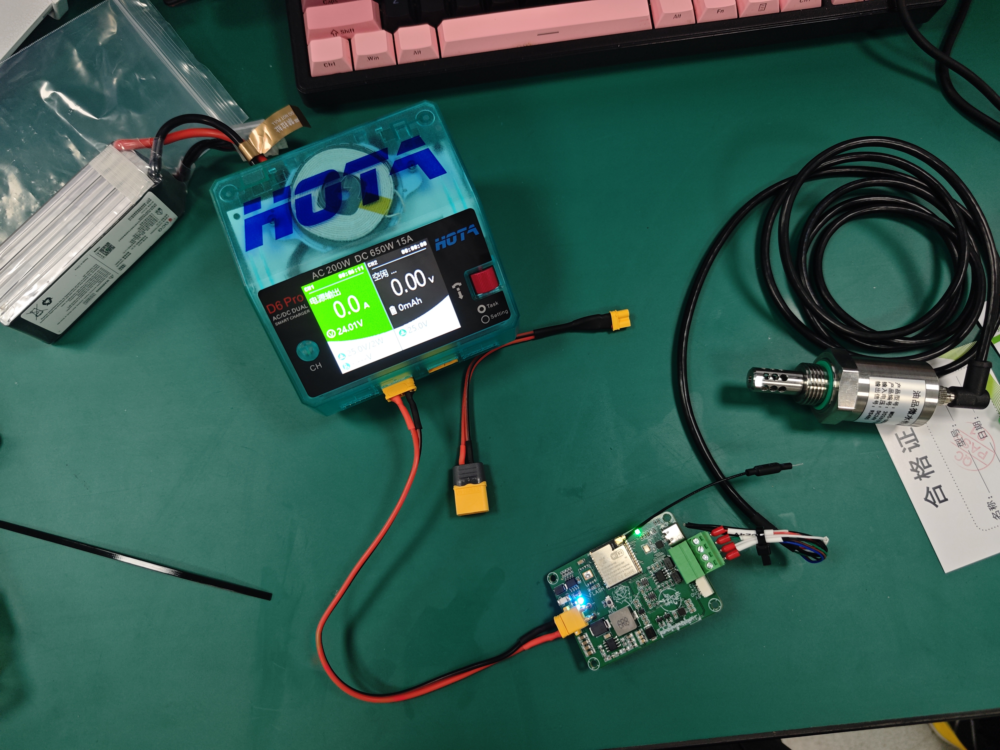 | 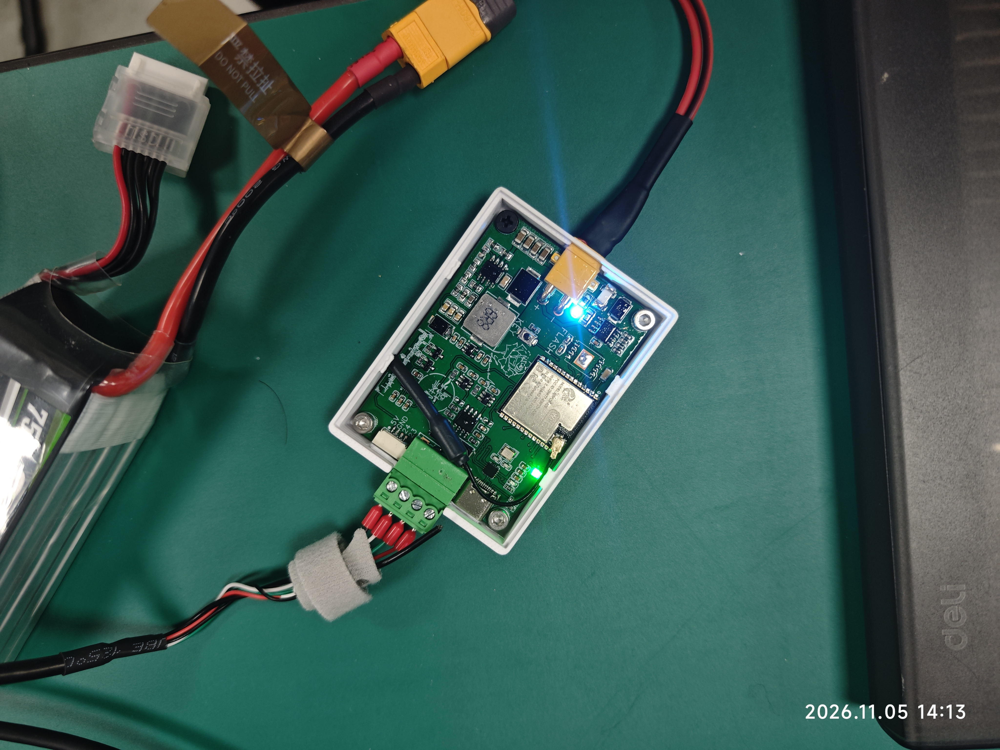 | 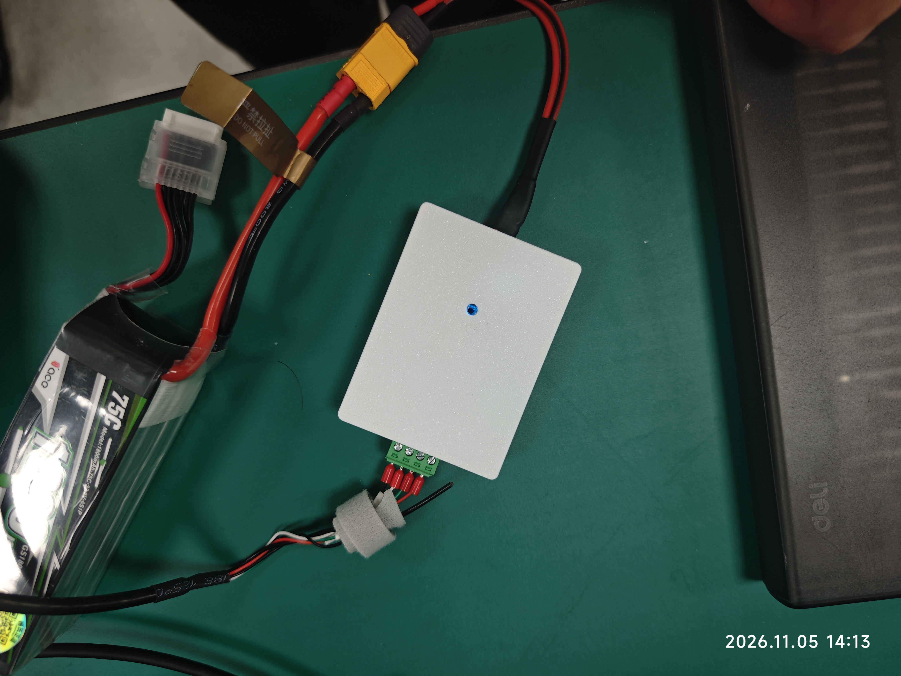 |
| HOTA 充电器 + 锂电池 + ESP32-C5 采集板 + MDS-680A 传感器 | ESP32-C5 + MAX485 + 天线 + 接线端子 | 白色外壳，状态指示灯 |

### 上位机界面

| 实时监测（单组 EIS） | 实时监测（9 组博德图） | 实时监测（9 组 Nyquist） |
|:---:|:---:|:---:|
| 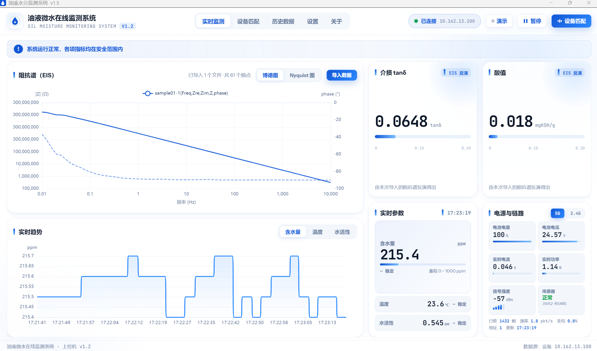 | 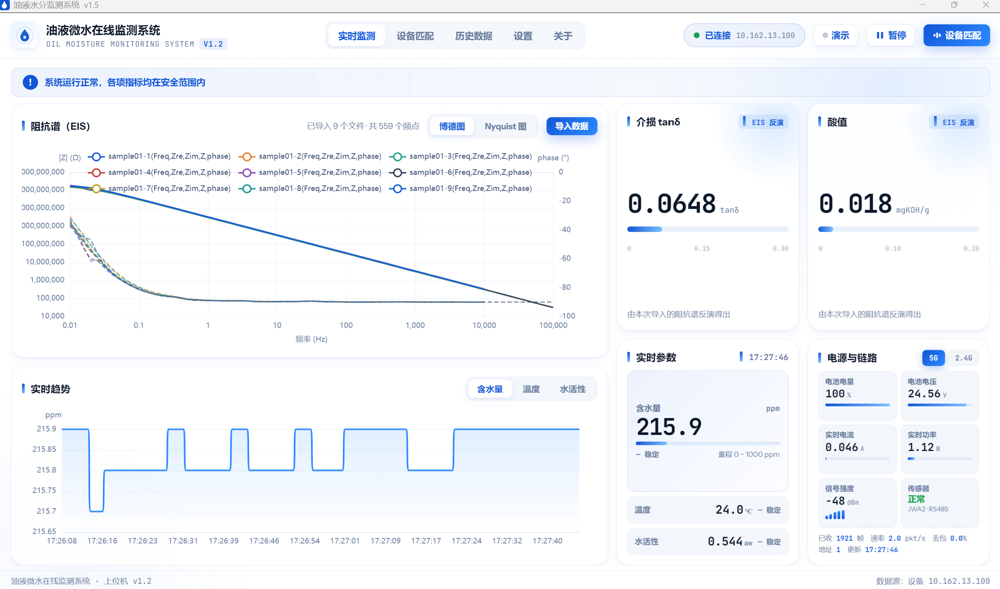 | 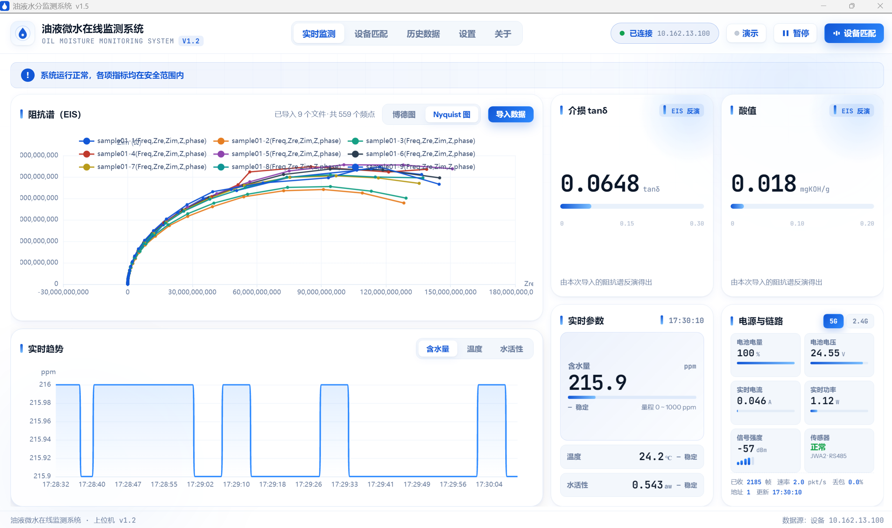 |

| 设备匹配 | 历史数据（正常） | 历史数据（原始收发） |
|:---:|:---:|:---:|
| 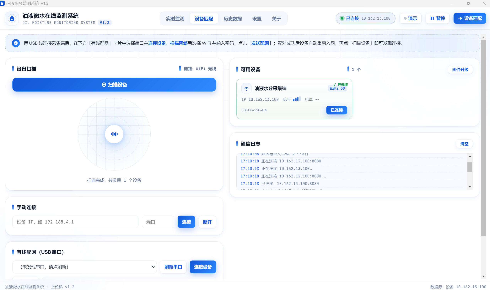 | 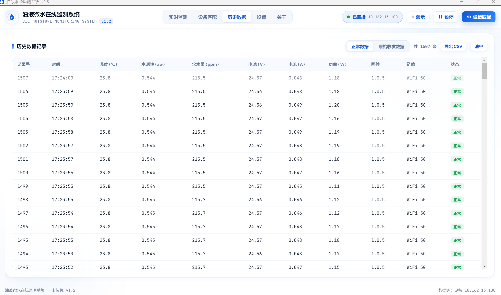 | 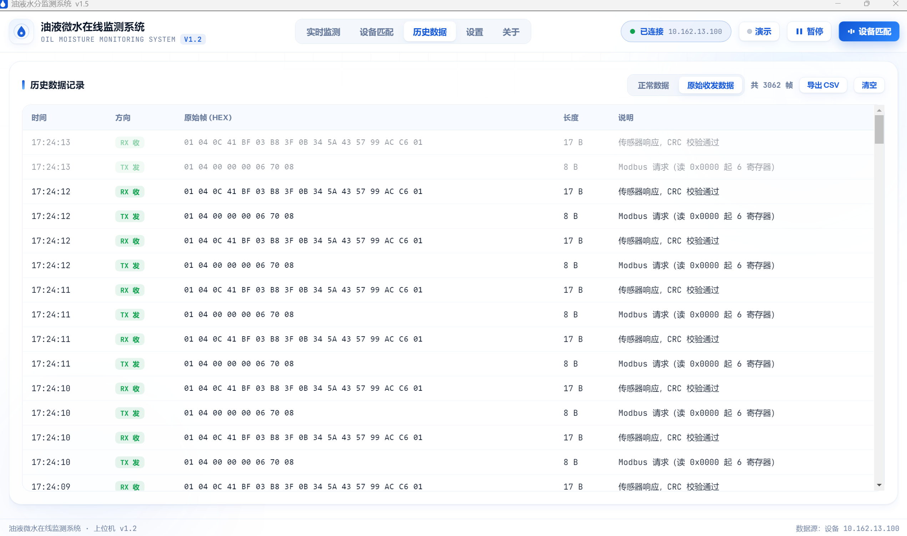 |

| 设置 | 关于 |
|:---:|:---:|
| 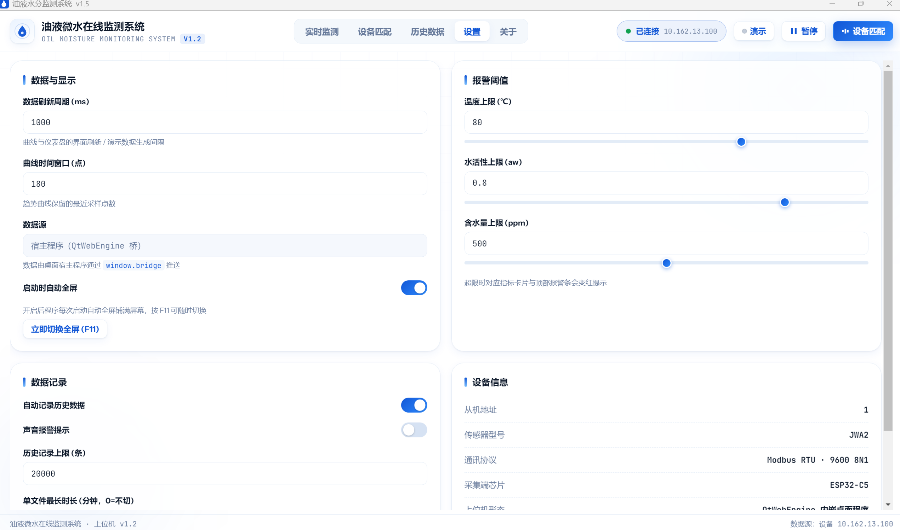 | 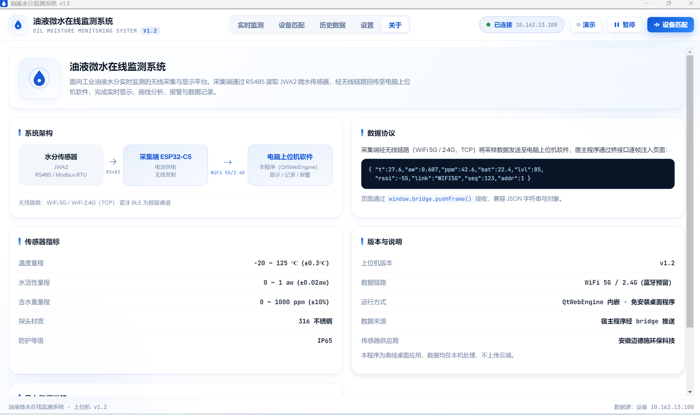 |

## 目录结构

```
工程包/
├── PCB/                  立创 EDA 原理图与 PCB 工程
├── firmware/             ESP32-C5 固件（PlatformIO / Arduino）
│   ├── src/              业务代码（传感器/RS485/无线/OTA/按键）
│   ├── platformio.ini    PlatformIO 工程配置
│   ├── ota_4MB.csv       4MB 双 OTA 分区表
│   └── flash.py          一键烧录脚本
├── oil-moisture-monitor/ 上位机前端（HTML/CSS/JS + ECharts）
│   ├── assets/           app.css / app.js
│   └── _shared/          字体与 echarts.min.js
├── 上位机/               PyQt5 上位机宿主 + 后端 + 打包脚本
│   ├── main.py           入口（QtWebEngine 窗口 + CLI 服务）
│   ├── backend.py        数据后端（TCP 接收 / CSV 存储 / 报警）
│   ├── cli.py            命令行接口（导入 EIS、自检、设备操作）
│   ├── eis_model.py      EIS→介损/酸值 纯 Python Transformer 推理
│   ├── eis_loader.py     阻抗谱 xlsx 批量解析
│   ├── eis_transformer_weights.json  模型权重（推理必需）
│   ├── build.py          PyInstaller 单文件打包脚本
│   └── ...
├── eis_model/            模型训练侧（数据生成 / 训练 / 导出权重）
│   ├── sim_data.py       仿真阻抗谱生成
│   ├── fr3_data.py       仪器频率网格 / 重采样
│   ├── train.py          Transformer 训练
│   └── infer_pure.py     纯 Python 推理（与上位机 eis_model.py 对齐）
└── photo/                硬件实物照片
```

## 一、固件

### 环境
- [PlatformIO](https://platformio.org/)（VS Code 插件）
- 开发板：ESP32-C5，Arduino 框架

### 编译与烧录
```powershell
cd firmware
pio run                    # 编译
pio run --target upload     # 烧录
# 或使用一键脚本：
python flash.py
```

### 分区表
`ota_4MB.csv` 为 4MB Flash 双 OTA 分区（ota0/ota1 各 1.25MB，littlefs 1.44MB）。分区表注释使用 ASCII，避免 Windows 下 GBK 解码报错。

### 首次配网
设备上电后长按按键进入配网模式，或通过 `firmware/provision_wifi.py` 串口下发 WiFi 凭据。

## 二、上位机

### 环境
- Python 3.11+
- 依赖：`PyQt5`、`pyserial`、`openpyxl`

```powershell
cd 上位机
pip install PyQt5 pyserial openpyxl
python main.py
```

### 功能
- 实时监测：含水量 ppm / 温度 / 水活性 实时曲线，报警阈值可配
- 设备匹配：扫描并绑定采集端设备
- 历史数据：CSV 存储与查询、导出
- 阻抗谱分析（EIS）：导入 xlsx 文件夹，博德图 / Nyquist 图 / 偏差对比三视图，支持 0.01Hz 低频频段聚焦；自动反演介损 tanδ 与酸值，可在「均值 / 逐组」间切换

### 打包为免安装 exe
```powershell
cd 上位机
python build.py
# 产物：dist/油液水分监测系统.exe
```
打包为单文件 `--onefile`，已禁用 QtWebEngine 沙箱以兼容企业 EDR 环境，普通用户双击即可运行，无需管理员权限。

## 三、EIS 阻抗谱反演

导入包含阻抗谱 xlsx 的文件夹后，程序对每个文件单独反演：

| 步骤 | 说明 |
|------|------|
| 输入 | 频率 / Zre / Zim / \|Z\| / 相位 |
| 频率网格 | 10 kHz → 0.01 Hz，共 61 点 |
| 重采样 | log10\|Z\| 与相位在 log10(f) 上线性插值（非标称网格自动重采样） |
| 输入特征 | `[lg f, slog(Zre), slog(Zim), lg\|Z\|, φ/90]` |
| 模型 | Transformer 编码器（自注意力 + 前馈，层归一化 + GELU + 均值池化） |
| 输出 | 介损 tanδ / 酸值 mgKOH/g / 老化天数 day |

权重文件 `上位机/eis_transformer_weights.json` 随程序分发，纯本机计算、不联网。多组导入时卡片默认显示各组均值与范围，点卡片标题右侧「逐组」可查看每组结果。预测值用于趋势参考，精确计量以实验室滴定法为准。

训练侧见 `eis_model/` 目录，更换模型只需替换 `上位机/eis_transformer_weights.json`，`eis_model.py` 无需改动。

## 四、通信协议

采集端经 WiFi TCP 上报 JSON 帧：
```json
{ "t": 27.6, "aw": 0.607, "ppm": 42.6, "bat": 22.4, "lvl": 85,
  "rssi": -55, "link": "WIFI5G", "seq": 123, "addr": 1 }
```
上位机通过 `window.bridge.pushFrame()` 注入页面，兼容 JSON 字符串与对象。

## 许可证

本项目仅供学习与工程参考使用。
